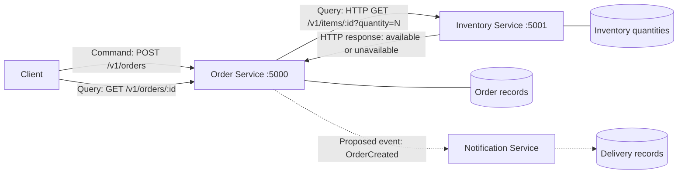

# Module 04: Online store services

`inventory.py` is extended with sample stock and
quantity-aware availability. `order.py` adds order creation and tracking using
the original Flask/Requests approach and dependency error handling.

## Architecture



The dashed Notification component is a design
proposal: no notification process, broker, or delivery is implemented. Order logs
`event=OrderCreated` after saving an order to mark where event publication would
occur; the log is not a delivered or durable event.

| Component | Responsibility | Owned data |
| --- | --- | --- |
| Order | Validate requests, check Inventory, create orders, and expose order lookup | Order ID, item ID, requested quantity, order status, creation timestamp |
| Inventory | Answer availability queries for the requested quantity | SKU identifiers and stock quantities |
| Notification (proposed) | Consume `OrderCreated` and notify the user | Notification templates, delivery attempts, and delivery status; recipient details would be supplied by a future event contract |

These boundaries separate order workflow, stock management, and message delivery.
Order references SKUs but does not own or directly read Inventory's stock map.
Inventory knows nothing about order records. A future Notification consumer could
retry delivery independently without blocking order creation. Each implemented
service has its own process and in-memory data; communication crosses an HTTP
boundary, not a shared Python import or shared dictionary.

## Command, Query, and Event

| Interaction | Classification | Why |
| --- | --- | --- |
| Check whether an item is available | Query | Requests current stock information without changing Inventory data. Order calls `GET /v1/items/<item_id>?quantity=N`. |
| Create an order | Command | Requests a state change. `POST /v1/orders` creates an Order-owned record only after a successful availability check. |
| Order was created | Event | Reports a fact that has already happened. A proposed `OrderCreated` event would carry the order ID, item ID, quantity, and timestamp for Notification to consume. |

An Inventory HTTP response answers the query; it is not the `OrderCreated` event.

## Run

From `module-04-lab`, create a local Python environment:

```sh
python3 -m venv .venv
.venv/bin/python -m pip install -r REST/requirements.txt
```

Run each service in a separate terminal, from this directory:

```sh
# Terminal 1
.venv/bin/python REST/inventory.py
```

```sh
# Terminal 2
.venv/bin/python REST/order.py
```

Inventory defaults to `127.0.0.1:5001`; Order defaults to `127.0.0.1:5000`.
Each supports the `PORT` environment variable. Order's `INVENTORY_URL` defaults
to `http://127.0.0.1:5001`. For example, if those ports are occupied:

```sh
# Terminal 1
PORT=5101 .venv/bin/python REST/inventory.py
# Terminal 2
PORT=5100 INVENTORY_URL=http://127.0.0.1:5101 .venv/bin/python REST/order.py
```

The retained `checkout.py` is the previous lab's optional availability proxy.
It also defaults to port 5000, so run it separately from Order if reviewing the
original workflow. Inventory retains its integer `available` field for that
client and adds the boolean `is_available` for the new Order client.

## Submit and track orders

Sample stock: `sku-123` has 7 units, `sku-456` has 0, and `sku-789` has 3.

```sh
curl -i http://127.0.0.1:5000/v1/orders \
  -H 'Content-Type: application/json' \
  -d '{"item_id":"sku-123","quantity":2}'
```

Returns **201 Created** with `order_id`, `item_id`, `quantity`, `status: created`,
`created_at`, and `request_id`. The `Location` header supplies the lookup path:

```sh
curl http://127.0.0.1:5000/v1/orders/REPLACE_WITH_ORDER_ID
```

An out-of-stock item or a quantity larger than current stock returns **409**
with `error: item_unavailable`. An unknown SKU returns **404** with
`error: item_not_found`. Invalid order JSON, a missing item ID, or a quantity
that is not a positive integer returns **400**. Quantity defaults to 1.
Failed submissions do not create orders.

## Failure test

1. Start both services and submit the successful order above.
2. Stop Inventory with **Ctrl+C** in terminal 1. Leave Order running.
3. Submit another order with the same curl command.
4. Check Order's health and the previously created order.

```sh
curl -i http://127.0.0.1:5000/health
curl -i http://127.0.0.1:5000/v1/orders/REPLACE_WITH_ORDER_ID
```

Order bounds the Inventory call with a 0.2-second connection timeout and a
0.6-second read timeout. Connection failure returns **503 Service Unavailable**;
a timeout returns **504 Gateway Timeout**; malformed data or an unexpected
dependency status returns **502 Bad Gateway**. These failures are handled inside
the request, so Order remains running and its existing records remain readable.
The request ID is sent to Inventory and returned in the Order response/header.

### Automated verification

```sh
.venv/bin/python -m unittest discover -s REST -v
```

The integration test starts Order and Inventory as distinct subprocesses on
temporary ports, creates and retrieves an order, checks unavailable/unknown
items and invalid requests, then **terminates the real Inventory process** and
submits another order. It checks Order is still alive and can serve health and
existing orders, then restarts Inventory and verifies a new order succeeds.
Separate contract tests check timeout and invalid dependency responses.

Observed test result:

```text
Available item: HTTP 201; tracking: HTTP 200
Unavailable item: HTTP 409; unknown item: HTTP 404; invalid orders: HTTP 400
Inventory stopped: HTTP 503 {"error":"dependency_unavailable","request_id":"8f0ddfc3-b8c6-4844-9715-e854afddd475"}
Order remains running: HTTP 200 {"service":"order","status":"ok"}
Inventory restarted: next order returns HTTP 201
Ran 3 tests — OK
```

The recorded request ID changes on each run. Existing order lookup also returned
HTTP 200 while Inventory was stopped. The timeout and malformed-response checks
use mocked HTTP responses; the stopped-process failure above uses real services.

### Scope and limitations

Stock queries do not reserve or decrement quantities. Concurrent or repeated
orders may therefore exceed stock; this lab demonstrates availability checking,
not safe stock allocation. A production extension would add an atomic Inventory
reservation command. Orders and stock are in memory; restarting Order loses its
records. There is no payment, authentication, idempotency, persistence, or actual
notification delivery. Flask's development server is sufficient for this lab.
