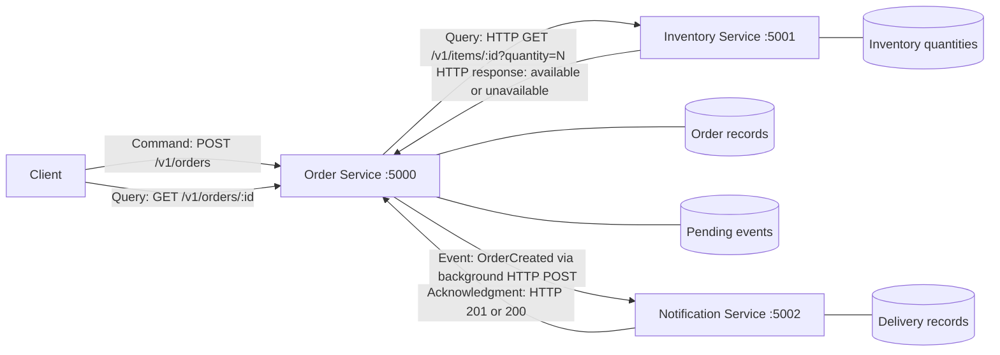
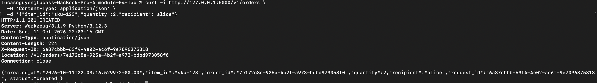
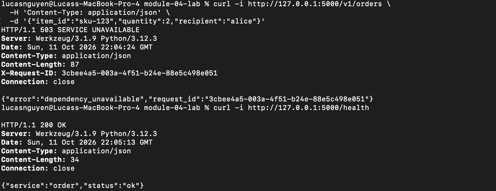

# Module 04: Online store services

`inventory.py` is extended with sample stock and
quantity-aware availability. 
`order.py` adds order creation and tracking using the original Flask/Requests approach and dependency error handling.
`notification.py` consumes order events and logs confirmations in its own process.

## Architecture



After saving an order, Order queues an `OrderCreated` event. A background worker posts queued events to Notification's `POST /v1/events` endpoint. Notification logs a confirmation and acknowledges it; Order retries every second until it receives HTTP 201 (new delivery) or HTTP 200 (duplicate already handled). Order creation does not wait for Notification. This small lab uses an in-memory queue and HTTP rather than adding a message broker or email provider.

| Component | Responsibility | Owned data |
| --- | --- | --- |
| Order | Validate requests, check Inventory, create orders, expose order lookup, and publish creation events | Order ID, item ID, requested quantity, recipient, order status, creation timestamp, and pending events |
| Inventory | Answer availability queries for the requested quantity | SKU identifiers and stock quantities |
| Notification | Consume `OrderCreated`, log confirmations, and suppress duplicate events | Delivery records: event ID, order ID, recipient, message, status, and delivery timestamp |

The boundaries separate order workflow, stock management, and message delivery. Order references SKUs, but does not own or directly read Inventory's stock map. Inventory knows nothing about order records. Notification processes events independently without blocking order creation. Each implemented service has its own process and in-memory data; communication crosses an HTTP boundary, not a shared Python import or shared dictionary.

## Command, Query, and Event

| Interaction | Classification | Why |
| --- | --- | --- |
| Check whether an item is available | Query | Requests current stock information without changing Inventory data. Order calls `GET /v1/items/<item_id>?quantity=N`. |
| Create an order | Command | Requests a state change. `POST /v1/orders` creates an Order-owned record only after a successful availability check. |
| Order was created | Event | Reports a fact that has already happened. `OrderCreated` carries the event ID, order ID, recipient, item ID, quantity, and creation timestamp for Notification to consume. |

An Inventory HTTP response answers the query; it is not the `OrderCreated` event.

## Run

From `module-04-lab`, create a local Python environment:

```sh
python3 -m venv .venv
.venv/bin/python -m pip install -r REST/requirements.txt
```

Run each service in a separate terminal, from this directory:

```sh
# Terminal 1
.venv/bin/python REST/inventory.py
```

```sh
# Terminal 2
.venv/bin/python REST/order.py
```

```sh
# Terminal 3
.venv/bin/python REST/notification.py
```

Order defaults to `127.0.0.1:5000`, Inventory to `127.0.0.1:5001`, and Notification
to `127.0.0.1:5002`. Each supports `PORT`. Order supports `INVENTORY_URL` and
`NOTIFICATION_URL`, defaulting to the addresses above. For alternate ports:

```sh
# Terminal 1
PORT=5101 .venv/bin/python REST/inventory.py
# Terminal 2
PORT=5100 INVENTORY_URL=http://127.0.0.1:5101 NOTIFICATION_URL=http://127.0.0.1:5102 .venv/bin/python REST/order.py
# Terminal 3
PORT=5102 .venv/bin/python REST/notification.py
```

## Sample run

Sample stock: `sku-123` has 7 units, `sku-456` has 0, and `sku-789` has 3.

```sh
curl -i http://127.0.0.1:5000/v1/orders \
  -H 'Content-Type: application/json' \
  -d '{"item_id":"sku-123","quantity":2,"recipient":"alice"}'
```

Returns **201 Created** with `order_id`, `item_id`, `quantity`, `status: created`,
`created_at`, `recipient`, and `request_id`. The `Location` header supplies the lookup path:



## Failure test



Order bounds the Inventory call with a 0.2-second connection timeout and a 0.6-second read timeout. Connection failure returns **503 Service Unavailable**; This failure is handled inside the request, so Order remains running and its existing records remain readable. 

## Why are clear service boundaries and data ownership important?
Clear service boundaries define what each service is responsible for. Data ownership defines which service has authority to read and change a particular kind of data. Together, they reduce coupling between modules/components and prevent conflicting decisions. Module/component isolation makes development and debugging much easier.