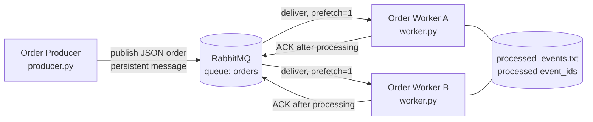

# Module 05: Asynchronous order messaging with RabbitMQ

`producer.py` publishes order messages to durable `orders` queue.
`worker.py` consumes them, logs each order, skips duplicate `event_id`s, and sends an ACK only after processing finishes.
The producer and each worker are independent processes; they only share the RabbitMQ queue.

## Architecture



Each message is:

```json
{"event_id": "<uuid4>", "order_id": "order-1", "item_id": "sku-123", "quantity": 3}
```

## Run

Start RabbitMQ:

```sh
docker compose up -d
```

Create a local Python environment:

```sh
python3 -m venv .venv
.venv/bin/python -m pip install -r requirements.txt
```

Run each process in its own terminal, from this directory:

```sh
# Terminal 1
.venv/bin/python worker.py --name worker-A
```

```sh
# Terminal 2
.venv/bin/python worker.py --name worker-B
```

```sh
# Terminal 3
.venv/bin/python producer.py --count 6
```

Other demos:

```sh
# Failure and redelivery: start crashing worker first, then a normal worker-B, then the producer
.venv/bin/python worker.py --name worker-A --crash-after-receive
.venv/bin/python worker.py --name worker-B
.venv/bin/python producer.py --count 2

# Duplicate handling: publishes order-1, order-2, then order-2 again with the same event_id
.venv/bin/python producer.py --count 2 --duplicate
```

`RABBITMQ_HOST` (default `127.0.0.1`) and `PROCESSED_FILE` (default `processed_events.txt` next to `worker.py`) can be overridden. Delete `processed_events.txt` to start with an empty history. Stop RabbitMQ with `docker compose down`.

## Evidence

The full logs from these runs are in [`logs/`](logs/).

### Successful processing and two competing consumers

Two workers on the same queue, producer publishes 6 orders:

```text
# producer
18:22:12 producer published event_id=188e1cfa-... order_id=order-1 item_id=sku-456 quantity=4
18:22:12 producer published event_id=c883cc49-... order_id=order-2 item_id=sku-789 quantity=2
18:22:12 producer published event_id=4f754a79-... order_id=order-3 item_id=sku-789 quantity=4
18:22:12 producer published event_id=7b9d8328-... order_id=order-4 item_id=sku-123 quantity=5
18:22:12 producer published event_id=f135d554-... order_id=order-5 item_id=sku-456 quantity=3
18:22:12 producer published event_id=ace584c0-... order_id=order-6 item_id=sku-789 quantity=2
```

```text
# worker-A
18:22:12 worker-A received event_id=c883cc49-... order_id=order-2 redelivered=False
18:22:12 worker-A processing order_id=order-2 item_id=sku-789 quantity=2
18:22:13 worker-A processed order_id=order-2
18:22:13 worker-A ACK sent event_id=c883cc49-...
18:22:13 worker-A received event_id=4f754a79-... order_id=order-3 redelivered=False
...
18:22:17 worker-A ACK sent event_id=f135d554-...          # order-5
```

```text
# worker-B
18:22:12 worker-B received event_id=188e1cfa-... order_id=order-1 redelivered=False
18:22:13 worker-B processing order_id=order-1 item_id=sku-456 quantity=4
18:22:14 worker-B processed order_id=order-1
18:22:14 worker-B ACK sent event_id=188e1cfa-...
18:22:14 worker-B received event_id=7b9d8328-... order_id=order-4 redelivered=False
...
18:22:18 worker-B ACK sent event_id=ace584c0-...          # order-6
```

worker-A handled orders 2, 3, 5 and worker-B handled orders 1, 4, 6. Every order was processed and ACKed exactly once, and no order appears in both logs. Workers are competing.

### Failure and redelivery

worker-A runs with `--crash-after-receive`; worker-B is normal. The producer publishes 2 orders:

```text
# worker-A
18:22:23 worker-A received event_id=094bd85a-... order_id=order-1 redelivered=False
18:22:23 worker-A simulated crash before ACK for order_id=order-1
# (process exits; no ACK was sent)
```

```text
# worker-B
18:22:23 worker-B received event_id=a3183cdf-... order_id=order-2 redelivered=False
18:22:23 worker-B processing order_id=order-2 item_id=sku-123 quantity=5
18:22:24 worker-B processed order_id=order-2
18:22:24 worker-B ACK sent event_id=a3183cdf-...
18:22:24 worker-B received event_id=094bd85a-... order_id=order-1 redelivered=True
18:22:24 worker-B processing order_id=order-1 item_id=sku-123 quantity=4
18:22:25 worker-B processed order_id=order-1
18:22:25 worker-B ACK sent event_id=094bd85a-...
```

```text
worker-A alive? no
worker-B alive? yes
```

worker-A received order-1 and died before ACK. When its connection closed, RabbitMQ requeued the nonACK message and delivered it to worker-B with `redelivered=True`. worker-B kept running and processed both orders. Afterwards the queue was empty:

```text
$ docker compose exec rabbitmq rabbitmqctl list_queues name messages_ready messages_unacknowledged
orders	0	0
```

### Duplicate handling

The producer publishes order-2 twice with the same `event_id`:

```text
# producer
18:22:30 producer published event_id=eb862d5e-... order_id=order-1 item_id=sku-123 quantity=3
18:22:30 producer published event_id=ea29f44a-... order_id=order-2 item_id=sku-123 quantity=3
18:22:30 producer published event_id=ea29f44a-... order_id=order-2 item_id=sku-123 quantity=3
```

```text
# worker-B
18:22:30 worker-B received event_id=ea29f44a-... order_id=order-2 redelivered=False
18:22:31 worker-B processing order_id=order-2 item_id=sku-123 quantity=3
18:22:32 worker-B processed order_id=order-2
18:22:32 worker-B ACK sent event_id=ea29f44a-...
```

```text
# worker-A
18:22:30 worker-A received event_id=eb862d5e-... order_id=order-1 redelivered=False
18:22:30 worker-A processing order_id=order-1 item_id=sku-123 quantity=3
18:22:31 worker-A processed order_id=order-1
18:22:31 worker-A ACK sent event_id=eb862d5e-...
18:22:31 worker-A received event_id=ea29f44a-... order_id=order-2 redelivered=False
18:22:32 worker-A duplicate detected event_id=ea29f44a-... order_id=order-2; skipping business action
18:22:32 worker-A ACK sent event_id=ea29f44a-...
```

Second copy went to the worker-A while worker-B was still processing the first. worker-A waited for the file lock, found the `event_id` already recorded, skipped the business action, and still ACKed so the duplicate left the queue.

## Why can a message be delivered more than once, and how does idempotent handling help?

RabbitMQ provides at-least-once delivery, it only removes a message after the consumer ACKs it. If a worker crashes, loses its connection, or times out after doing the work, but before the ACK reaches the broker, the message is requeued and delivered again. Producers can also send the same event twice, like when they retry a publish after a network error. The broker cannot tell whether the business action already happened, so the consumer has to handle repeats safely. Idempotent handling uses a stable `event_id` to record which events have been processed already. If processed already, do nothing but still ACK to get out of queue. That lets the system keep the reliability of redelivery without double-reserving inventory or double-charging a customer.
