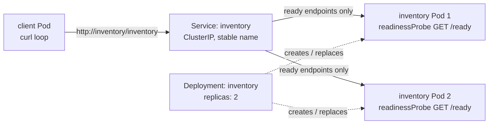

# Module 06: Inventory Service on Kubernetes

`inventory/app.py` is a small HTTP server. `GET /inventory` returns stock along with name of the Pod that handled the request, `GET /ready` is used by the readiness probe. `/ready` returns 503 while `/tmp/unready` exists in the container, so readiness can be failed with `kubectl exec`.
`k8s.yaml` has `inventory` Deployment (2 replicas with a readiness probe), `inventory` ClusterIP Service, and a `client` Deployment. The client is a `curl` loop that hits `http://inventory/inventory` every second, so it only knows the Service name and never a Pod IP.

## Architecture



## Deploy

Needs Colima, kind, kubectl, and the docker CLI. From this directory:

```sh
colima start --cpu 2 --memory 4
kind create cluster --name module-06
docker build -t inventory:1.0 inventory
kind load docker-image inventory:1.0 --name module-06
kubectl apply -f k8s.yaml
kubectl rollout status deploy/inventory
```

Follow the client to see which Pod answers each request:

```sh
kubectl logs -f deploy/client
```

Check which Pods the Service is routing to. A Pod showing `false` under `READY` doesn't get traffic:

```sh
kubectl get endpointslices -l kubernetes.io/service-name=inventory \
  -o custom-columns='POD:.endpoints[*].targetRef.name,IP:.endpoints[*].addresses[0],READY:.endpoints[*].conditions.ready'
```

Other demos:

```sh
POD=$(kubectl get pods -l app=inventory -o jsonpath='{.items[0].metadata.name}')

# Readiness failure, then recovery
kubectl exec $POD -- touch /tmp/unready
kubectl exec $POD -- rm /tmp/unready

# Pod failure: the Deployment creates a replacement with a new name
kubectl delete pod $POD
kubectl get pods -l app=inventory -o wide
```

Tear down with `kind delete cluster --name module-06`, then `colima stop`.

## Evidence

The full terminal output from these runs is in [`logs/`](logs/).

### Both replicas receiving requests

Both Pods are `Running` and ready, and the Service has both of them as endpoints:

```text
$ kubectl get pods -o wide
NAME                        READY   STATUS    RESTARTS   AGE   IP
client-554c6966f5-stk25     1/1     Running   0          60s   10.244.0.4
inventory-bf696b8ff-8w99l   1/1     Running   0          60s   10.244.0.7
inventory-bf696b8ff-t6jr6   1/1     Running   0          60s   10.244.0.6

$ kubectl get svc inventory
NAME        TYPE        CLUSTER-IP      EXTERNAL-IP   PORT(S)   AGE
inventory   ClusterIP   10.96.137.103   <none>        80/TCP    60s

POD                                                   IP                      READY
inventory-bf696b8ff-t6jr6,inventory-bf696b8ff-8w99l   10.244.0.6,10.244.0.7   true,true
```

Calling Inventory from the client Pod by Service name:

```text
$ kubectl exec deploy/client -- curl -s http://inventory/inventory
{"pod": "inventory-bf696b8ff-8w99l", "stock": {"sku-123": 42, "sku-456": 7}}
```

Client log:

```text
$ kubectl logs deploy/client --tail=10
04:57:34 {"pod": "inventory-bf696b8ff-t6jr6", ...}
04:57:35 {"pod": "inventory-bf696b8ff-8w99l", ...}
04:57:36 {"pod": "inventory-bf696b8ff-t6jr6", ...}
04:57:37 {"pod": "inventory-bf696b8ff-8w99l", ...}
...

$ kubectl logs deploy/client --tail=20 | grep -o '"pod": "[^"]*"' | sort | uniq -c
  10 "pod": "inventory-bf696b8ff-8w99l"
  10 "pod": "inventory-bf696b8ff-t6jr6"
```

Each replica's own log:

```text
$ kubectl logs pod/inventory-bf696b8ff-8w99l --tail=2
[inventory-bf696b8ff-8w99l] "GET /inventory HTTP/1.1" 200 -
[inventory-bf696b8ff-8w99l] "GET /inventory HTTP/1.1" 200 -

$ kubectl logs pod/inventory-bf696b8ff-t6jr6 --tail=2
[inventory-bf696b8ff-t6jr6] "GET /inventory HTTP/1.1" 200 -
[inventory-bf696b8ff-t6jr6] "GET /inventory HTTP/1.1" 200 -
```

The last 20 requests split evenly, 10 to each replica. The client never addresses a Pod directly. It sends every request to the Service, which picks one of the ready Pods.

### Readiness failure and recovery

`touch /tmp/unready` on `8w99l` makes its probe return 503. The Pod is still `Running` with no restarts, but it shows `0/1` and is marked `false` in the endpoints:

```text
$ kubectl exec inventory-bf696b8ff-8w99l -- touch /tmp/unready

$ kubectl get pods -l app=inventory
NAME                        READY   STATUS    RESTARTS   AGE
inventory-bf696b8ff-8w99l   0/1     Running   0          67s
inventory-bf696b8ff-t6jr6   1/1     Running   0          67s

POD                                                   IP                      READY
inventory-bf696b8ff-t6jr6,inventory-bf696b8ff-8w99l   10.244.0.6,10.244.0.7   true,false

LAST SEEN   TYPE      REASON      OBJECT                          MESSAGE
2s          Warning   Unhealthy   pod/inventory-bf696b8ff-8w99l   Readiness probe failed: HTTP probe failed with statuscode: 503
```

Client while `8w99l` is unready:

```text
04:57:51 {"pod": "inventory-bf696b8ff-t6jr6", ...}
04:57:52 {"pod": "inventory-bf696b8ff-t6jr6", ...}
...
04:57:58 {"pod": "inventory-bf696b8ff-t6jr6", ...}
```

Every request went to `t6jr6`. After removing the file, `8w99l` goes back to `1/1` and starts getting requests again:

```text
$ kubectl exec inventory-bf696b8ff-8w99l -- rm /tmp/unready

inventory-bf696b8ff-8w99l   1/1     Running   0          80s

POD                                                   IP                      READY
inventory-bf696b8ff-t6jr6,inventory-bf696b8ff-8w99l   10.244.0.6,10.244.0.7   true,true

04:58:04 {"pod": "inventory-bf696b8ff-t6jr6", ...}
04:58:05 {"pod": "inventory-bf696b8ff-8w99l", ...}
04:58:06 {"pod": "inventory-bf696b8ff-8w99l", ...}
04:58:07 {"pod": "inventory-bf696b8ff-t6jr6", ...}
```

### Pod deletion and replacement

Deleting `8w99l`:

```text
$ kubectl delete pod inventory-bf696b8ff-8w99l --wait=false
pod "inventory-bf696b8ff-8w99l" deleted from default namespace

$ kubectl get pods -l app=inventory -o wide
NAME                        READY   STATUS    RESTARTS   AGE   IP
inventory-bf696b8ff-scwbg   0/1     Running   0          1s    10.244.0.8
inventory-bf696b8ff-t6jr6   1/1     Running   0          92s   10.244.0.6

# 12s later
inventory-bf696b8ff-scwbg   1/1     Running   0          13s   10.244.0.8
inventory-bf696b8ff-t6jr6   1/1     Running   0          104s  10.244.0.6

$ kubectl get svc inventory
NAME        TYPE        CLUSTER-IP      EXTERNAL-IP   PORT(S)   AGE
inventory   ClusterIP   10.96.137.103   <none>        80/TCP    104s

POD                                                   IP                      READY
inventory-bf696b8ff-t6jr6,inventory-bf696b8ff-scwbg   10.244.0.6,10.244.0.8   true,true
```

The Deployment created `scwbg` right away with a new name and IP (`10.244.0.8`). The Service didn't change: same name, same ClusterIP `10.96.137.103`. Only the endpoint behind it changed, from `.7` to `.8`.

Client during the replacement:

```text
04:58:11 {"pod": "inventory-bf696b8ff-t6jr6", ...}
...
04:58:18 {"pod": "inventory-bf696b8ff-t6jr6", ...}
04:58:19 {"pod": "inventory-bf696b8ff-scwbg", ...}
04:58:20 {"pod": "inventory-bf696b8ff-scwbg", ...}
04:58:22 {"pod": "inventory-bf696b8ff-t6jr6", ...}
04:58:26 {"pod": "inventory-bf696b8ff-scwbg", ...}
```

`t6jr6` handled everything until `scwbg` was ready, then traffic split across both again. The client's command never changed and none of its requests failed.

## Why is a stable Service name useful when Pods can fail or be replaced?

Pods aren't permanent. When `8w99l` was deleted, its replacement came back as `scwbg` with a different IP, so anything pointing at the old Pod's address would have broken too. The `inventory` Service gives the client one DNS name and ClusterIP that stay the same, and Kubernetes updates the endpoints behind it as Pods come and go. The readiness probe works through that same endpoint list, which is why the unready Pod stopped getting traffic without any change on the client side. The client only has to know `inventory`, not which Pods happen to be running.
