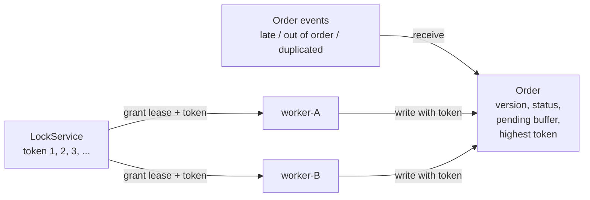

# Module 07: Versioned order events and fencing tokens

`order_processor.py` simulates an order moving through `CREATED → PAID → SHIPPED`. Each update is an event:

```json
{"order_id": "order-1", "version": 2, "status": "PAID"}
```

An `Order` keeps its last applied `version` and applies only `version + 1`:

- **Older or equal version, or one already buffered:** duplicate, ignored.
- **Version further ahead (a gap):** buffered in `pending`, and the missing versions are logged. The order's status stays where it is.
- **Next version:** applied. Then any buffered versions that now follow in sequence are drained in order.

Worker writes also carry a fencing token from `LockService`, which increases on every lock grant. The order remembers the highest token it has seen and rejects any write with a lower one.

## Architecture



## Run

Needs Python 3, no dependencies. From this directory:

```sh
python3 order_processor.py
```

It runs all three tests in sequence and logs to stdout.

## Evidence

Full output from the run is in [`logs/run.log`](logs/run.log).

### Correct event ordering and duplicate handling

Delivered order: version 2, version 1, version 2 again.

```text
21:51:51 === Test 1: versioned ordering and duplicates (deliver v2, v1, v2 again) ===
21:51:51 received order_id=order-1 version=2 status=PAID
21:51:51 out of order order_id=order-1 version=2 buffered as pending; waiting for version(s) [1]
21:51:51 received order_id=order-1 version=1 status=CREATED
21:51:51 applied order_id=order-1 version=1 status None -> CREATED
21:51:51 applied order_id=order-1 version=2 status CREATED -> PAID
21:51:51 received order_id=order-1 version=2 status=PAID
21:51:51 duplicate order_id=order-1 version=2; ignoring (current version=2)
21:51:51 state order_id=order-1 version=2 status=PAID pending=[] missing=[]
```

Version 2 came first, so it was held in `pending` while waiting for version 1. When version 1 came, it was applied and then the buffered version 2 was applied right after, giving `None → CREATED → PAID`. The second copy of version 2 was ignored since the order was already at version 2, so `PAID` was applied only once.

### Missing event

Version 1 is delivered, then version 3. Version 2 never arrives.

```text
21:51:51 === Test 2: missing event (deliver v1, then v3 while v2 never arrives) ===
21:51:51 received order_id=order-2 version=1 status=CREATED
21:51:51 applied order_id=order-2 version=1 status None -> CREATED
21:51:51 received order_id=order-2 version=3 status=SHIPPED
21:51:51 out of order order_id=order-2 version=3 buffered as pending; waiting for version(s) [2]
21:51:51 state order_id=order-2 version=1 status=CREATED pending=[3] missing=[2]
```

The order stays at `CREATED` and doesn't jump to `SHIPPED` without having been `PAID`. Version 3 is recorded as pending, and version 2 is reported as missing. If version 2 arrives later, both get applied in order.

### Stale worker rejection

worker-A gets the lock with token 1, then pauses (like a GC pause) long enough for its lease to expire. worker-B gets the lock with token 2 and writes. worker-A then wakes up and tries to write with its old token.

```text
21:51:51 === Test 3: stale worker rejected by fencing token ===
21:51:51 received order_id=order-3 version=1 status=CREATED
21:51:51 applied order_id=order-3 version=1 status None -> CREATED
21:51:51 lock granted to worker-A on order_id=order-3 token=1
21:51:51 worker-A pauses (e.g. GC pause) and its lease expires before it writes
21:51:51 lock granted to worker-B on order_id=order-3 token=2
21:51:51 accepted worker-B token=2 order_id=order-3
21:51:51 received order_id=order-3 version=2 status=PAID
21:51:51 applied order_id=order-3 version=2 status CREATED -> PAID
21:51:51 worker-A resumes, still believing it holds the lock
21:51:51 REJECTED worker-A token=1 order_id=order-3 version=3: stale token (highest seen=2)
21:51:51 accepted worker-B token=2 order_id=order-3
21:51:51 received order_id=order-3 version=3 status=SHIPPED
21:51:51 applied order_id=order-3 version=3 status PAID -> SHIPPED
21:51:51 state order_id=order-3 version=3 status=SHIPPED pending=[] missing=[]
```

worker-B (token 2) updated the order. worker-A's write had a valid next version (3) but was rejected anyway, because token 1 is lower than the highest token the order has seen. The check is on the token, not on the event. Only the current lock holder, worker-B, could ship the order.

## Why are timestamps alone not enough to guarantee correct event ordering in a distributed system?

Each machine has its own clock, and clocks drift and get corrected by NTP, so a timestamp from one node can't be safely compared with one from another. Two events can also get the same timestamp, or a later event can get an earlier timestamp from a node with a slow clock. If events at 10:00:01 and 10:00:03 arrive, nothing says whether there was an event in between that is still delayed. A per-order version number is assigned in sequence, so the receiver knows exactly which update comes next, can detect a missing one, and can treat a repeated version as a duplicate. In the same way, a fencing token comes from one counter, so a paused worker can't sneak in an old write just because its clock or lease thinks it's still valid.
