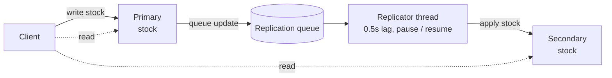

# Module 08: Primary/secondary replication and stale reads

`replication.py` simulates a small inventory system with one `stock` value stored on two replicas:

- **Primary:** takes every write. It applies the new value right away and puts it on a replication queue.
- **Replicator:** a background thread that takes updates off the queue and applies them to the secondary after a `REPLICATION_LAG` of 0.5s. It can be paused to simulate a slow or broken link, and resumed later.
- **Secondary:** only gets values through the replicator. It never takes writes directly.
- **Client:** writes to the primary and can read from either replica. `wait_until_converged` reads the secondary every 0.2s until it matches the primary.

Replication is asynchronous, so a write returns as soon as the primary has it. It doesn't wait for the secondary.

## Architecture



## Run

Needs Python 3, no dependencies. From this directory:

```sh
python3 replication.py
```

Both replicas start at `stock=0`. It runs the three tests in sequence and logs to stdout.

## Evidence

Full output from the run is in [`logs/run.log`](logs/run.log).

### Replication

The client writes `stock=10` to the primary, then keeps reading the secondary until it matches.

```text
14:02:10.553 === Test 1: replication (write stock=10 to primary) ===
14:02:10.553 client write stock=10 to primary
14:02:10.553 primary applied stock 0 -> 10
14:02:10.553 primary queued stock=10 for replication
14:02:10.553 client read primary -> stock=10
14:02:10.553 client read secondary -> stock=0
14:02:10.758 client read secondary -> stock=0
14:02:10.964 client read secondary -> stock=0
14:02:11.058 replicating stock=10 to secondary
14:02:11.059 secondary applied stock 0 -> 10
14:02:11.167 client read secondary -> stock=10
14:02:11.168 CONVERGED primary=10 secondary=10
```

The primary had 10 immediately. The secondary kept returning 0 for about half a second, then the replicator applied the update and the secondary returned 10. Both replicas now agree on `stock=10`.

### Stale read

Replication is paused, then the client writes `stock=9` to the primary and reads both replicas, once right away and once after 1.5s (three times the normal lag).

```text
14:02:11.168 === Test 2: stale read (pause replication, write stock=9) ===
14:02:11.168 replication to secondary PAUSED
14:02:11.168 client write stock=9 to primary
14:02:11.168 primary applied stock 10 -> 9
14:02:11.168 primary queued stock=9 for replication
14:02:11.168 client read primary -> stock=9
14:02:11.168 client read secondary -> stock=10
14:02:11.168 waiting 1.5s, longer than the normal replication lag
14:02:12.674 client read primary -> stock=9
14:02:12.674 client read secondary -> stock=10
14:02:12.674 STALE READ: primary=9 but secondary=10
```

The primary returns 9, but the secondary still returns 10. The update is sitting in the replication queue and can't reach the secondary while replication is paused. A client that reads from the secondary sees an old value. That is a stale read: it would think there are 10 items in stock when there are only 9.

### Recovery and convergence

Replication is resumed, and the client reads the secondary until it matches the primary.

```text
14:02:12.674 === Test 3: recovery and convergence (resume replication) ===
14:02:12.674 replication to secondary RESUMED
14:02:12.675 client read primary -> stock=9
14:02:12.675 client read secondary -> stock=10
14:02:12.880 client read secondary -> stock=10
14:02:13.084 client read secondary -> stock=10
14:02:13.180 replicating stock=9 to secondary
14:02:13.180 secondary applied stock 10 -> 9
14:02:13.289 client read secondary -> stock=9
14:02:13.290 CONVERGED primary=9 secondary=9
```

The queued update wasn't lost during the pause. Once replication resumed, the replicator delivered `stock=9` after the normal lag, and both replicas returned 9 again.

## What tradeoff exists between reading quickly from a replica and guaranteeing that the reader sees the latest value?

Reading from the secondary is fast and takes load off the primary, but with asynchronous replication the secondary can be behind, so the reader may get an old value like `stock=10` after the primary already has 9. To guarantee the latest value, the client has to read from the primary or wait for the secondary to confirm each write before returning. Both make the system slower and less available. Every read or write then depends on the primary, or both replicas, being reachable. This is latency and availability against consistency.
