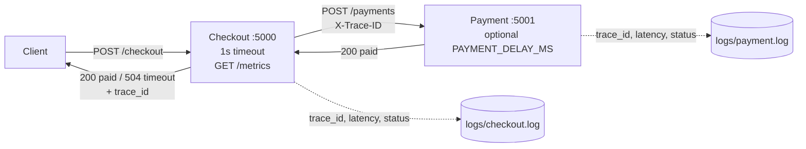

# Module 09: Observing a Checkout → Payment timeout

Two Flask services:

- **Checkout** (`checkout.py`, port 5000): `POST /checkout` takes an order, calls Payment with a 1-second timeout, and returns the result. `GET /metrics` returns the request, success, and failure counts, the error rate, and the latency of the last request.
- **Payment** (`payment.py`, port 5001): `POST /payments` marks the order paid. If `PAYMENT_DELAY_MS` is set, it sleeps that long first, to simulate a slow dependency.

Observability:

- **Trace ID:** Checkout creates a `trace_id` for each request, sends it to Payment in the `X-Trace-ID` header, and returns it to the client. Both services put it on every log line.
- **Request logs:** each service logs `event=started` and `event=finished` for every request. Checkout logs failures at `ERROR` with the status and the error.
- **Latency:** each `event=finished` line has `latency_ms`. Checkout also reports `last_latency_ms` in `/metrics`.
- **Success/failure counts:** Checkout counts `requests_total`, `success_total`, and `failure_total` in `/metrics` and derives `error_rate` from them.

If Payment doesn't answer within 1 second, Checkout returns `504` with `payment_timeout`. If Payment can't be reached or returns an error, Checkout returns `502` with `payment_unavailable`. Either way, the failure is handled inside the request, so Checkout keeps running.

## Architecture



## Run

Needs Python 3. From this directory:

```sh
python3 -m venv .venv
.venv/bin/python -m pip install -r requirements.txt
```

Start each service in its own terminal. Logs go to the terminal and are appended to `logs/`:

```sh
# Terminal 1
.venv/bin/python checkout.py 2>&1 | tee -a logs/checkout.log
```

```sh
# Terminal 2
.venv/bin/python payment.py 2>&1 | tee -a logs/payment.log
```

Send an order and check the metrics:

```sh
curl -s -X POST http://127.0.0.1:5000/checkout -H 'Content-Type: application/json' -d '{"order_id":"order-1","amount":25.0}'
curl -s http://127.0.0.1:5000/metrics
```

**Failure test:** stop Payment (Ctrl+C) and restart it with a delay longer than Checkout's 1-second timeout. Leave Checkout running.

```sh
# Terminal 2
PAYMENT_DELAY_MS=2000 .venv/bin/python payment.py 2>&1 | tee -a logs/payment.log
```

**Recovery:** stop Payment again and restart it without the delay:

```sh
# Terminal 2
.venv/bin/python payment.py 2>&1 | tee -a logs/payment.log
```

To follow a request across both services, grep its `trace_id` in both logs:

```sh
grep -H <trace_id> logs/checkout.log logs/payment.log | sort -t: -k2
```

## Evidence

The client output is in [`logs/client.log`](logs/client.log), and the service logs are in [`logs/checkout.log`](logs/checkout.log) and [`logs/payment.log`](logs/payment.log). The run sent 1 order normally, 3 with Payment delayed, and 5 after the delay was removed.

### Successful request

```text
$ curl -s -X POST http://127.0.0.1:5000/checkout -H 'Content-Type: application/json' -d '{"order_id":"order-1","amount":25.0}'
{"order_id":"order-1","payment":"paid","trace_id":"6503cfd630a4463c97b2bdc7af8bee9c"}
 HTTP 200 in 0.012871s
$ curl -s http://127.0.0.1:5000/metrics
{"error_rate":0.0,"failure_total":0,"last_latency_ms":10.2,"requests_total":1,"success_total":1}
```

The same trace ID shows up in both services:

```text
logs/checkout.log:14:20:58.003 INFO trace_id=6503cfd630a4463c97b2bdc7af8bee9c event=started order_id=order-1
logs/payment.log:14:20:58.012 INFO trace_id=6503cfd630a4463c97b2bdc7af8bee9c event=started order_id=order-1 amount=25.0 delay_ms=0
logs/payment.log:14:20:58.012 INFO trace_id=6503cfd630a4463c97b2bdc7af8bee9c event=finished status=200 latency_ms=0.2
logs/checkout.log:14:20:58.013 INFO trace_id=6503cfd630a4463c97b2bdc7af8bee9c event=finished status=200 latency_ms=10.2 error=None
```

### Timeout failure

Payment restarted with `PAYMENT_DELAY_MS=2000`. Every checkout gave up after about 1 second and returned `504`:

```text
$ curl -s -X POST http://127.0.0.1:5000/checkout -H 'Content-Type: application/json' -d '{"order_id":"order-2","amount":25.0}'
{"error":"payment_timeout","trace_id":"5288b1e4a3e4453d86dd82a89c1e4bde"}
 HTTP 504 in 1.004541s
$ curl -s -X POST http://127.0.0.1:5000/checkout -H 'Content-Type: application/json' -d '{"order_id":"order-3","amount":25.0}'
{"error":"payment_timeout","trace_id":"9f495fbe785e4ba3a6c22440a458a5a3"}
 HTTP 504 in 1.006696s
$ curl -s -X POST http://127.0.0.1:5000/checkout -H 'Content-Type: application/json' -d '{"order_id":"order-4","amount":25.0}'
{"error":"payment_timeout","trace_id":"7d2c730d29254d7590cfb6fbb334ee3e"}
 HTTP 504 in 1.004235s
$ curl -s http://127.0.0.1:5000/metrics
{"error_rate":0.75,"failure_total":3,"last_latency_ms":1002.5,"requests_total":4,"success_total":1}
```

Checkout's log marks each failed request at `ERROR` with the status, the latency, and the cause:

```text
14:20:59.554 INFO trace_id=5288b1e4a3e4453d86dd82a89c1e4bde event=started order_id=order-2
14:21:00.557 ERROR trace_id=5288b1e4a3e4453d86dd82a89c1e4bde event=finished status=504 latency_ms=1002.6 error=payment_timeout
14:21:00.577 INFO trace_id=9f495fbe785e4ba3a6c22440a458a5a3 event=started order_id=order-3
14:21:01.581 ERROR trace_id=9f495fbe785e4ba3a6c22440a458a5a3 event=finished status=504 latency_ms=1004.4 error=payment_timeout
14:21:01.606 INFO trace_id=7d2c730d29254d7590cfb6fbb334ee3e event=started order_id=order-4
14:21:02.608 ERROR trace_id=7d2c730d29254d7590cfb6fbb334ee3e event=finished status=504 latency_ms=1002.5 error=payment_timeout
```

Following the first failed request's trace ID across both logs:

```text
$ grep -H 5288b1e4a3e4453d86dd82a89c1e4bde logs/checkout.log logs/payment.log | sort -t: -k2
logs/checkout.log:14:20:59.554 INFO trace_id=5288b1e4a3e4453d86dd82a89c1e4bde event=started order_id=order-2
logs/payment.log:14:20:59.557 INFO trace_id=5288b1e4a3e4453d86dd82a89c1e4bde event=started order_id=order-2 amount=25.0 delay_ms=2000
logs/checkout.log:14:21:00.557 ERROR trace_id=5288b1e4a3e4453d86dd82a89c1e4bde event=finished status=504 latency_ms=1002.6 error=payment_timeout
logs/payment.log:14:21:01.562 INFO trace_id=5288b1e4a3e4453d86dd82a89c1e4bde event=finished status=200 latency_ms=2005.2
```

The trace shows where the time went. Payment logged the request 3 ms after Checkout received it, so the call reached Payment quickly. Checkout gave up at 1 second, and Payment finished a second later with `latency_ms=2005.2`. So the cause is Payment being slow, not Payment being down. It also shows that Payment still marked `order-2` paid even though the client was told it failed. A real system would need an idempotency key, or a status check before retrying, to avoid charging twice.

### Recovery

Payment restarted without the delay. Checkout was never restarted. The client output records `pid 40846 still running` at this point.

```text
$ curl -s -X POST http://127.0.0.1:5000/checkout -H 'Content-Type: application/json' -d '{"order_id":"order-5","amount":25.0}'
{"order_id":"order-5","payment":"paid","trace_id":"241b38756a164972b56b4018bee22830"}
 HTTP 200 in 0.006700s
$ curl -s -X POST http://127.0.0.1:5000/checkout -H 'Content-Type: application/json' -d '{"order_id":"order-6","amount":25.0}'
{"order_id":"order-6","payment":"paid","trace_id":"8b078d15a057436cbc70a328cf6bb733"}
 HTTP 200 in 0.002390s
$ curl -s -X POST http://127.0.0.1:5000/checkout -H 'Content-Type: application/json' -d '{"order_id":"order-7","amount":25.0}'
{"order_id":"order-7","payment":"paid","trace_id":"e968c2154e54468999481851c55d98e2"}
 HTTP 200 in 0.001997s
$ curl -s -X POST http://127.0.0.1:5000/checkout -H 'Content-Type: application/json' -d '{"order_id":"order-8","amount":25.0}'
{"order_id":"order-8","payment":"paid","trace_id":"7124bc93fa014b9d83f9f28aeb6a5e52"}
 HTTP 200 in 0.001802s
$ curl -s -X POST http://127.0.0.1:5000/checkout -H 'Content-Type: application/json' -d '{"order_id":"order-9","amount":25.0}'
{"order_id":"order-9","payment":"paid","trace_id":"96cc45e071504f33ac6dc37930bb3a42"}
 HTTP 200 in 0.001707s
$ curl -s http://127.0.0.1:5000/metrics
{"error_rate":0.33,"failure_total":3,"last_latency_ms":1.1,"requests_total":9,"success_total":6}
```

| Phase | Requests | Successes | Failures | Error rate | Checkout latency |
| --- | --- | --- | --- | --- | --- |
| Normal | 1 | 1 | 0 | 0.00 | 10.2 ms |
| Payment delayed | 4 | 1 | 3 | 0.75 | 1002.5–1004.4 ms |
| Recovered | 9 | 6 | 3 | 0.33 | 1.1–5.0 ms |

The counts are cumulative. All 5 requests after recovery succeeded, so `failure_total` stayed at 3 and the error rate dropped from 0.75 to 0.33. Latency went from about 1 second, which was the timeout, back to a few milliseconds.

## How do logs, traces, and metrics help diagnose failures in a distributed system?

Metrics show that something is wrong and how bad it is. Here the error rate jumped to 0.75 and latency sat at about 1000 ms, right at the timeout. Logs explain what happened to a single request: Checkout's `ERROR` line gives the status, the latency, and `payment_timeout` as the cause. A trace ID ties those lines to the matching lines in the other service, which showed that Payment received the request and finished it after 2 seconds, so Payment was slow, not down or unreachable. Together they lead you to the exact service and cause. Metrics can then confirm the recovery when the error rate falls and latency returns to normal.
